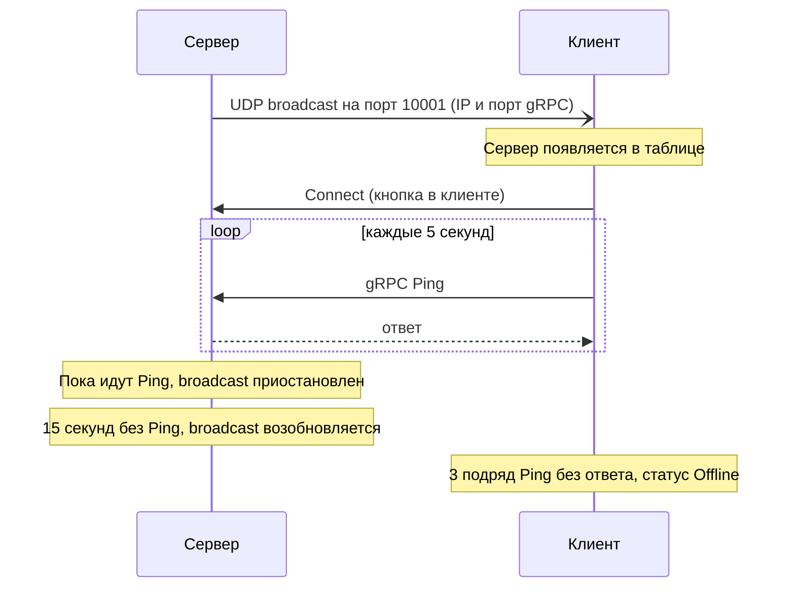

# Qt-Grpc-Test

> **Это небольшой тестовый проект**, выполненный в рамках тестового задания. Он показывает подход к решению задачи и не претендует на роль готовой функциональной программы.

Пара небольших приложений на **C++ / Qt** (сервер и клиент), которые находят друг друга по **UDP broadcast** и поддерживают связь через **gRPC** с помощью периодического вызова процедуры `Ping`.

**[ЗАПОЛНИТЬ: скриншот клиента с таблицей серверов, например `docs/client.png`]**

## Возможности

- автоматическое обнаружение серверов по UDP broadcast (порт 10001);
- подключение и отключение по кнопке **Connect / Disconnect**;
- контроль соединения периодическим gRPC-вызовом `Ping` каждые 5 секунд;
- автоматический переход в **Offline** при потере связи (три пропущенных `Ping` подряд);
- приостановка broadcast на сервере, пока есть активное соединение.

## Как это устроено



### Сервер

После запуска (кнопкой в интерфейсе) сервер начинает broadcast в UDP-порт **10001**. В сообщении указаны IP-адрес и порт, по которым к серверу подключаются gRPC-клиенты.

Когда клиент подключается, он начинает циклически вызывать процедуру `Ping` каждые **5 секунд**. Пока вызовы `Ping` проходят успешно, broadcast приостановлен. Он возобновляется, если с момента последнего вызова `Ping` прошло **15 секунд**.

### Клиент

Клиент показывает таблицу обнаруженных серверов:

| Столбец | Что показывает |
|---|---|
| **IP** | Адрес и порт сервера, обнаруженного по broadcast на UDP-порту 10001 |
| **Last ping time** | Время последнего вызова `Ping` для этого сервера |
| **Status** | Текущий статус сервера: Online или Offline |
| **Action** | Кнопка **Connect / Disconnect** |

Поведение:

- **Connect**: клиент каждые 5 секунд вызывает `Ping` для этого сервера, статус становится **Online**.
- **Disconnect**: циклический `Ping` останавливается, статус становится **Offline**.
- **Обрыв соединения** (нет ответа на 3 вызова `Ping` подряд): циклический `Ping` останавливается, статус становится **Offline**.

### Интерфейс gRPC

Описание лежит в `Proto/api.proto` (синтаксис `proto3`):

```protobuf
message PingRequest  { string clientIp = 1; }
message PingResponse {}

service MaintainingApi {
  rpc Ping (PingRequest) returns (PingResponse) {}
}
```

Клиент передаёт в `PingRequest` свой IP-адрес (`clientIp`), сервер отвечает пустым `PingResponse`.

### Состав приложений

| Приложение | Основные классы и файлы |
|---|---|
| Сервер | `Server`, `ServerMainWindow` (окно на Qt Widgets, форма `.ui`) |
| Клиент | `Client`, `ClientMainWindow` (окно на Qt Widgets, форма `.ui`), `ServersModel` (модель таблицы серверов), `ConnectionButtonDelegate` (кнопка Connect / Disconnect в таблице) |

## Структура проекта

```
.
├── Server/                    # серверное приложение
├── Client/                    # клиентское приложение
├── Proto/
│   └── api.proto              # описание gRPC-интерфейса
└── QtGrpc.sln                 # решение Visual Studio (проекты Server и Client)
```

## Сборка

Проект рассчитан на Windows и собирается в Visual Studio (`QtGrpc.sln`, платформа **x64**, конфигурации Debug и Release).

Требования:

- Visual Studio 2022 (toolset **v143**), Windows SDK 10.0;
- Qt **6.2.4** (`msvc2019_64`) и расширение **Qt Visual Studio Tools**; используемые модули: Core, Gui, Network, Widgets, а у сервера ещё StateMachine;
- gRPC для C++, установленный отдельно для каждой конфигурации: `C:\libs\grpc\debug` и `C:\libs\grpc\release` (в каждой папке подкаталоги `include`, `lib`, `bin`);
- стандарт C++20 (задан в конфигурации Release).

Если gRPC лежит в другом месте, нужно поправить пути в настройках проектов Server и Client:

- Configuration Properties → C/C++ → General → Additional Include Directories
- Configuration Properties → Linker → General → Additional Library Directories
- Configuration Properties → Linker → Command Line → Additional Options
- Configuration Properties → Build Events → Pre-Build Event → Command Line
- Configuration Properties → VC++ Directories → Include Directories и Library Directories (в проекте Client)

Pre-Build Event запускает `build_proto.bat` из папки проекта, ему параметром передаётся путь к папке `bin` установленного gRPC. Сгенерированные файлы `api.pb.*` и `api.grpc.pb.*` подключаются из папки `generated`. Pre-Build Event настроен для конфигурации Release.

## Запуск

1. Запустите **сервер** (`Server`) и нажмите кнопку запуска. Он начнёт рассылку broadcast.
2. Запустите **клиент** (`Client`). В таблице появится обнаруженный сервер.
3. Нажмите **Connect**: статус сменится на **Online**, а время последнего `Ping` начнёт обновляться.
4. Остановите сервер или нажмите **Disconnect**, чтобы увидеть переход в **Offline**.

## Допущения и ограничения

- Проект рассчитан только на Windows (Visual Studio 2022, x64).
- UDP broadcast работает только внутри одной подсети и не проходит через маршрутизаторы.
- Брандмауэр может блокировать UDP-порт 10001 и порт gRPC, их нужно разрешить.
- Таймауты (5 и 15 секунд, три пропущенных `Ping`) заданы в коде.